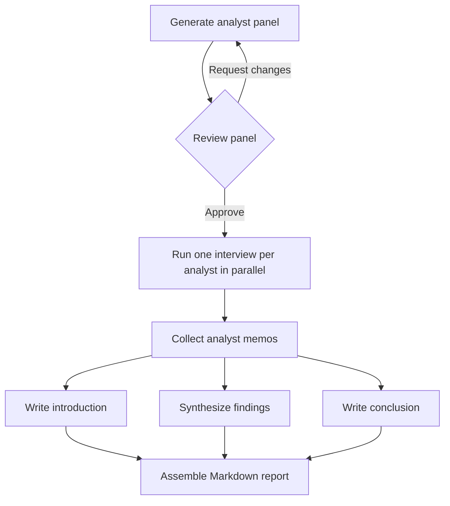

# Research Assistant with LangGraph

Turn a research question into a Markdown report with source links. Given a topic and a panel size, the assistant proposes AI analyst personas with different areas of focus. You can revise the panel before it starts researching. Each approved analyst then interviews a model acting as an expert, using evidence retrieved from the web. The graph combines their findings into a single report.

## Run locally

The project uses Python 3.12 and uv. You’ll need an OpenAI API key with access to `gpt-4o` and a Tavily API key for web search. A live report uses both services. [Install uv](https://docs.astral.sh/uv/getting-started/installation/)

```sh
git clone https://github.com/Karim-mans/Research_Assistant_LangGraph.git
cd Research_Assistant_LangGraph
uv sync --locked
```

Create a file named `.env` beside `langgraph.json` and fill in your own keys. Git ignores this file.

```dotenv
OPENAI_API_KEY=your-openai-key
TAVILY_API_KEY=your-tavily-key
LANGSMITH_TRACING=false
```

To record model calls and graph traces in LangSmith, set `LANGSMITH_TRACING=true` and add `LANGSMITH_API_KEY`. You can choose the tracing project with `LANGSMITH_PROJECT`. [LangSmith tracing guide](https://docs.langchain.com/langsmith/trace-with-langchain)

Start the development server from the repository root and keep it running while using Studio.

```sh
uv run --locked langgraph-research-agent
```

Open the Studio URL printed by the CLI. The local server also exposes a health check at `http://127.0.0.1:2024/ok` and interactive API docs at `http://127.0.0.1:2024/docs`. If the health check succeeds but Studio cannot connect, check the browser’s local network permission for LangSmith. [Studio connection guide](https://docs.langchain.com/langsmith/troubleshooting-studio)

## Generate your first report

1. In Studio, select **`research_agent`**, start a new thread, and submit the following JSON as the graph input.

   ```json
   {
     "topic": "How does bus service frequency affect ridership in mid-sized cities?",
     "max_analysts": 2
   }
   ```

2. The run pauses at `human_feedback` and shows the proposed analysts. Resume the **same thread** with a text reply. For example, `Include a transit operations planner` generates a revised panel for review. Reply `continue` to approve the panel and start the interviews. In a JSON resume editor, enter the string `"continue"` with quotes.
3. When the run finishes, open **`final_report`** in the final state and copy the Markdown. It contains the introduction, synthesized findings, conclusion, and source list when the model supplies one. The individual analyst memos are available in `sections`.

## How the research runs



Each interview starts with the analyst asking a question. Two parallel search nodes each generate a query and call Tavily for up to three results. The expert model receives the accumulated excerpts and is prompted to cite its answers. After two expert replies by default, the subgraph saves the transcript and writes a memo from the retrieved sources and the analyst’s focus.

Both search nodes currently use the same provider and prompt, so their results can overlap. The two-analyst example above makes eight Tavily searches if the model returns two analysts and each completes both turns. Citations are model-generated and worth checking against the linked sources.

If Tavily reports an error, the search node stops and surfaces the provider’s error in the run.

## Graphs you can run

All three graphs are registered in [langgraph.json](langgraph.json).

| Graph | Starting input | Result |
| --- | --- | --- |
| [`research_agent`](src/langgraph_research_agent/agent.py) | `topic`, `max_analysts` | Runs panel review, parallel interviews, and report assembly. Read `final_report`. |
| [`create_analysts`](src/langgraph_research_agent/creating_analysts.py) | `topic`, `max_analysts` | Runs the panel review on its own. Read `analysts` after approval. |
| [`answering_questions`](src/langgraph_research_agent/answering_questions.py) | An `analyst` with `name`, `affiliation`, `role`, and `description`, plus an opening user message in `messages`. Set `max_num_turns` to change the interview length. | Runs one interview. Read `interview` for the transcript, `context` for retrieved excerpts, and `sections` for the memo. |

## Development

The graph entry points above define which nodes run and in what order. To change the research behavior, start with these files.

| File | What to change |
| --- | --- |
| [nodes.py](src/langgraph_research_agent/utils/nodes.py) | Analyst generation, web retrieval, interview responses, and report assembly |
| [edges.py](src/langgraph_research_agent/utils/edges.py) | Approval routing, parallel interview dispatch, and the turn limit |
| [states.py](src/langgraph_research_agent/utils/states.py) | Graph state fields and how results from parallel branches are collected |
| [objects.py](src/langgraph_research_agent/utils/objects.py) | Structured model outputs for analyst profiles and search queries |
| [prompts.py](src/langgraph_research_agent/utils/prompts.py) | Instructions for analysts, expert answers, citations, and report sections |
| [models.py](src/langgraph_research_agent/utils/models.py) | OpenAI model and temperature |

Run the regression tests locally. They use the Python standard library and make no API calls.

```sh
uv run --locked python -m unittest discover -s tests -v
```
